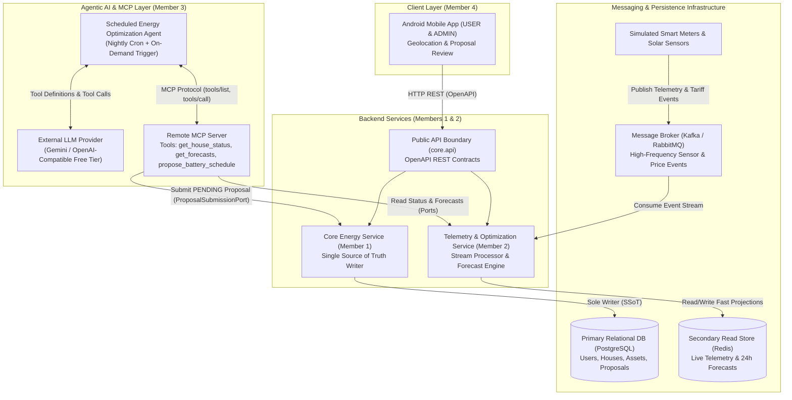
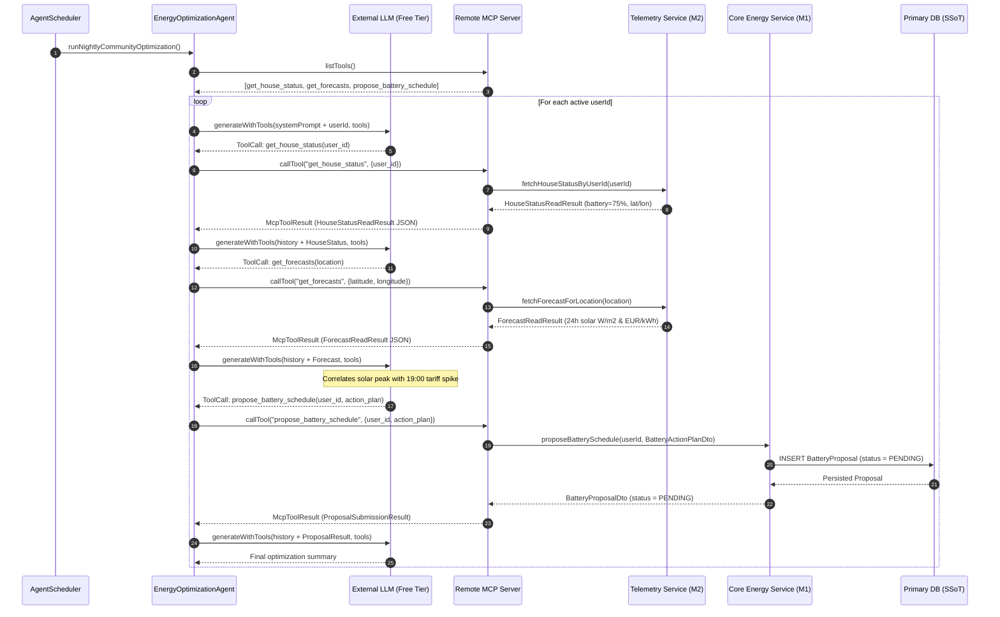
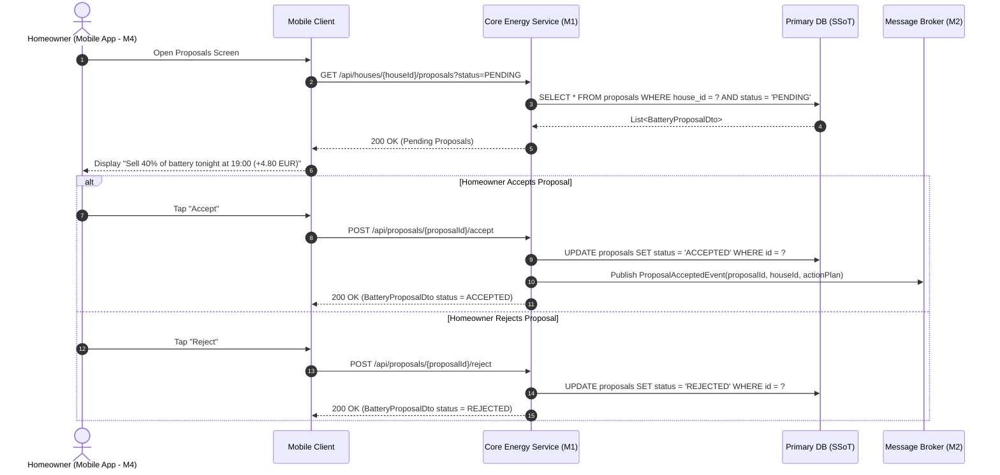
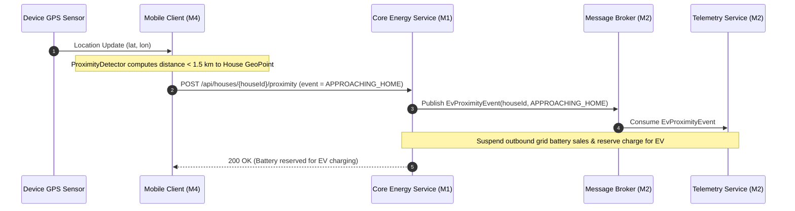
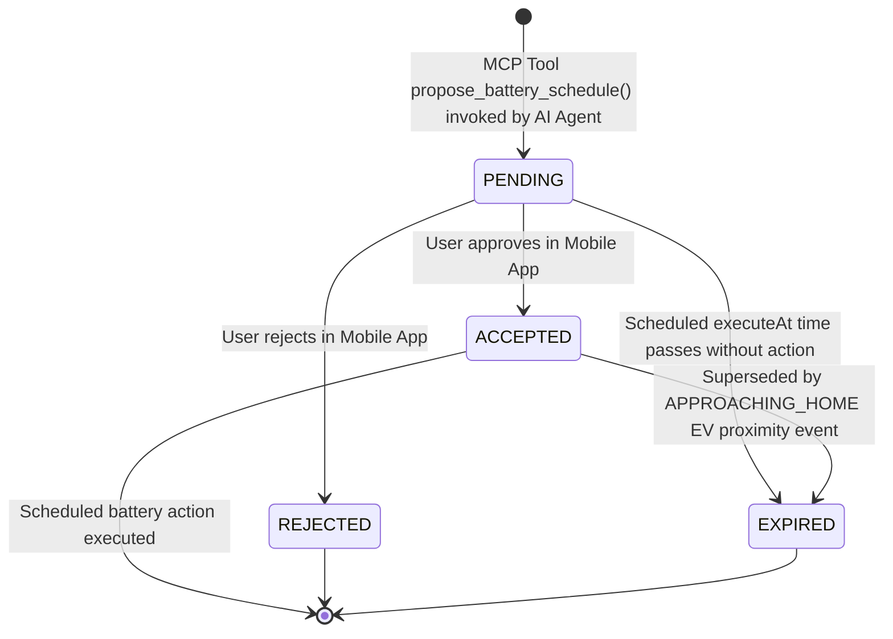

# System Architecture, Requirements & Diagrams — Energy Community

> **Note:** This document is a living architectural specification. Interface contracts for **Member 3 (MCP Server & Agentic AI)** and **Member 4 (Mobile Client)** are finalized; backend REST/broker details for **Member 1 (Core Energy Service)** and **Member 2 (Telemetry & Streaming)** will be updated as their respective interface PRs are merged.

---

## 1. High-Level Distributed Architecture

The **Energy Community** platform is designed as an event-driven, distributed system composed of four distinct runtime components, a message broker, a primary relational store (Single Source of Truth), and a fast telemetry read store.

---

## 2. Package Structure & Component Boundaries

| Package | Owner | Visibility | Architectural Role |
| :--- | :--- | :--- | :--- |
| `EnergyCommunity.core.api` | Co-owned (Backend) | `PUBLIC` | Shared service interfaces and DTOs exposed to external callers. |
| `EnergyCommunity.core.database` | Member 1 (Bianca) | `PRIVATE` | **Single Source of Truth** persistence layer for `User`, `House`, `Battery`, `SolarPanel`, and `BatteryProposal`. |
| `EnergyCommunity.messageBroker` | Member 2 (Vlad) | `TRANSPORT` | Asynchronous pub/sub event bus (Kafka/RabbitMQ) decoupling smart-meter sensors from downstream consumers. |
| `EnergyCommunity.core.telemetry` | Member 2 (Vlad) | `INTERNAL` | Consumes broker events, builds fast read views in Redis, and computes consumption averages and 24h forecasts. |
| `EnergyCommunity.core.mcpServer` | Member 3 (Luca) | `PROTOCOL` | Exposes the remote MCP Server (`McpServerContract`), the 3 MCP tools, and the scheduled AI optimization agent (`EnergyOptimizationAgentContract`). |
| `EnergyCommunity.user.mobileApp` | Member 4 (Tatiana) | `CLIENT` | Android application (Jetpack Compose) supporting `USER` and `ADMIN` roles, GPS proximity detection, and proposal approval. |
| `EnergyCommunity.deployment` | Shared (Vlad + Team) | `INFRA` | Dockerization, health checks, and service startup orchestration. |

---

## 3. Member 3 Specification: MCP Server & Agentic AI (`EnergyCommunity.core.mcpServer`)

### 3.1 Model Context Protocol (MCP) Tools

The MCP Server (`McpServerContract`) exposes three tools over remote transport:

1. **`get_house_status(user_id)` — Read Tool (`GetHouseStatusToolContract`)**
   - **Input:** `user_id` (`String`)
   - **Output (`HouseStatusReadResult`):** `houseId`, `location` (`latitude`, `longitude`, `regionName`), `batteryLevelPercent` (0–100%), `batteryCapacityKwh`, `currentConsumptionKw`, `currentSolarProductionKw`, `evApproachingHome` (`boolean`), and `updatedAt` (`Instant`).
   - **Data Source:** Queries the backend read projection via `HouseStatusQueryPort`.

2. **`get_forecasts(location)` — Read Tool (`GetForecastsToolContract`)**
   - **Input:** `location` (`GeoLocationInput`: `latitude`, `longitude`, `regionName`)
   - **Output (`ForecastReadResult`):** 24-hour chronological list of `ForecastPointData(time, solarRadiationWm2, pricePerKwh)`.
   - **Data Source:** Queries the Telemetry & Forecast service via `ForecastQueryPort`.

3. **`propose_battery_schedule(user_id, action_plan)` — Propose Change Tool (`ProposeBatteryScheduleToolContract`)**
   - **Input:** `user_id` (`String`) and `action_plan` (`BatteryActionPlan`: `houseId`, `actionType`, `batteryPercentage`, `executeAt`, `estimatedProfitEur`, `description`, `reasoning`).
   - **Output (`ProposalSubmissionResult`):** Registered `BatteryProposal` with initial status `ProposalStatus.PENDING`.
   - **Data Source:** Forwards the proposal via `ProposalSubmissionPort` so that only the Core Energy Service writes to the primary database.

### 3.2 Scheduled Agentic Workflow (`EnergyOptimizationAgentContract`)

Unlike a reactive chatbot, the `EnergyOptimizationAgentContract` is triggered every evening by `AgentSchedulerContract` (or on-demand for live demonstrations) and executes an autonomous multi-step reasoning loop:
1. Discovers available tools from `McpServerContract.listTools()`.
2. Calls `get_house_status(user_id)` via `McpServerContract.callTool(...)` to inspect current battery charge and whether an EV is approaching home.
3. Calls `get_forecasts(location)` via `McpServerContract.callTool(...)` using the household's coordinates.
4. Sends the telemetry and 24-hour forecast context to `LlmClientContract` to determine the optimal charge/discharge window (e.g., charging from solar midday and selling 40% of stored battery energy during the 19:00 evening tariff peak).
5. Calls `propose_battery_schedule(user_id, action_plan)` to register the `PENDING` proposal for the homeowner.

---

## 4. Sequence Diagrams (Stage 1.5)

### 4.1 Nightly Agentic Energy Optimization via MCP

### 4.2 User Proposal Review & Approval in Mobile App

### 4.3 Geolocation EV Proximity Override

---

## 5. Proposal Lifecycle State Diagram

